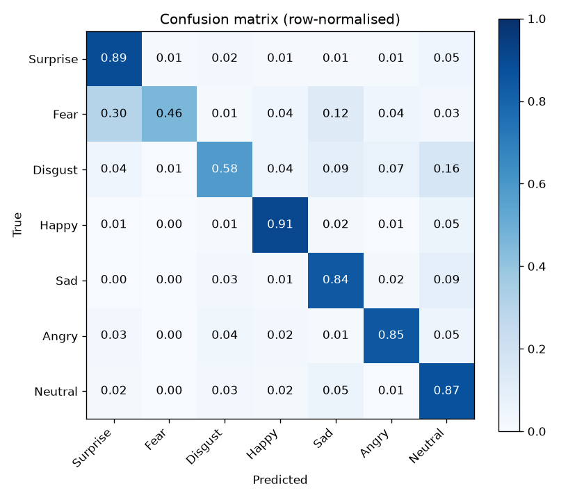
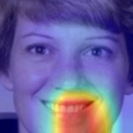

# Facial Expression Detection

Detects faces in a photo or webcam frame and classifies each into one of 7 emotions —
**Surprise, Fear, Disgust, Happy, Sad, Angry, Neutral** — using a ResNet18 fine-tuned on the
RAF-DB dataset. Comes with a live webcam web app.

> 🔗 **Live demo:** _add your Hugging Face Space link here_



## Features

| Feature | What it does |
|---|---|
| 🎥 Live detection | Real-time webcam analysis, every face labelled with its expression |
| 👥 Room mood | Average expression of everyone in frame |
| 📈 Emotion timeline | Live 60-second chart, session summary, CSV export |
| 🔥 Explainability | Grad-CAM heatmap showing which face regions drove the prediction |
| 😎 Emoji mask | Emoji matching your expression follows your face |
| 📸 Smile shutter | Takes a photo automatically when you smile |
| 🎮 Expression Challenge | 8-round game: match the prompted expression fast; streaks and high score |

## How it works

```
Webcam ──► YuNet face detector ──► align eyes + crop ──► ResNet18 (fine-tuned on RAF-DB) ──► smoothed
            (OpenCV DNN)          (matches RAF-DB style)    + mirror test-time augmentation   7-emotion probabilities
```

| Part | Choice | Why |
|---|---|---|
| Dataset | RAF-DB basic (~12.3k train / ~3.1k test, 100×100 aligned faces) | Real-world faces, varied pose/lighting |
| Model | ResNet18, transfer learning | Strong accuracy, small (~45 MB), trains on a laptop |
| Imbalance | Square-root class weights + label smoothing | "Happy" is ~40% of the data; "Fear"/"Disgust" are rare |
| Augmentation | Flip, rotation, colour jitter, random erasing | Reduces overfitting |
| Validation | 10% of train held out; test set used **once** at the end | Honest test score |
| Face detection | OpenCV YuNet (232 KB model in `models/`) + eye-level alignment | Webcam crops look like RAF-DB's aligned training faces |
| Augmentation for webcam | Random crop scale, blur, greyscale | Robust to framing and camera quality |
| Pipeline check | `calibrate.py` runs detect→align→predict on test images and picks the crop margin | Verifies the live app matches the benchmark |

## Results

| Metric | Value |
|---|---|
| Test accuracy | 84.2% |
| Macro F1 | 0.759 |

**What the model looks at** — Grad-CAM on a smiling face (NASA public-domain portrait): the model focuses on the mouth.



Training curves: `assets/training_curves.png` · Full report: `assets/classification_report.txt`

## Project structure

```
facial-expression-detection/
├── common.py          # labels, transforms, model, face detection
├── train.py           # training loop → models/best_model.pth
├── evaluate.py        # test-set metrics + confusion matrix
├── calibrate.py       # checks the webcam pipeline, saves best crop margin
├── predict.py         # CLI: python predict.py photo.jpg
├── app.py             # FastAPI server for the live webcam app
├── static/index.html  # web UI (live video, face box, confidence bars)
├── requirements.txt
├── models/            # trained weights (best_model.pth)
└── assets/            # plots and reports for this README
```

## Run it locally

```bash
python3 -m venv venv && source venv/bin/activate
pip install -r requirements.txt
# put the RAF-DB folder here as DATASET/train/1..7 and DATASET/test/1..7
python train.py --data DATASET --epochs 15
python evaluate.py --data DATASET
python calibrate.py --data DATASET
python app.py            # opens http://localhost:7860
```

## Dataset & licence

RAF-DB is for **non-commercial research only** and may not be redistributed, so it is not
included in this repository. Get it from the official site or Kaggle and place it in `DATASET/`.
Label mapping: folders `1..7` = Surprise, Fear, Disgust, Happy, Sad, Angry, Neutral.

## Limitations

- Trained on posed/aligned face crops; accuracy drops on side profiles, low light, and small faces.
- "Fear" and "Disgust" are the weakest classes because they have the fewest samples.
- Facial expression ≠ inner feeling. This model reads visible expressions only.

## Author

Priyanka Tadikonda · [GitHub](https://github.com/priyankatadikonda27) · [LinkedIn](https://linkedin.com/in/priyanka-tadikonda-017b05371)
